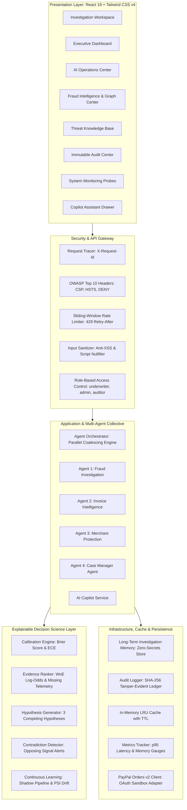

# PayPal TrustShield AI — Enterprise Architecture Specification

> **Platform:** PayPal TrustShield AI — Enterprise Fraud Operations & Risk Intelligence  
> **Audience:** PayPal Enterprise Architecture Board, Trust & Safety Engineering, Hackathon Evaluation Committee  
> **Standard:** Clean Architecture, Domain-Driven Design (DDD), Zero-Trust Isolation  

---

## 1. System Philosophy & Non-Destructive Invariant

PayPal TrustShield AI is architected as an **explainable, multi-agent advisory system**. It automates the cognitive burden of fraud investigation for underwriters while adhering to a fundamental fintech safety invariant:

```
INVARIANT: TrustShield AI NEVER automatically freezes or restricts a merchant account.
Adverse actions require human underwriter validation with mandatory written justification.
```

Legitimate merchants frequently experience sudden viral marketing spikes (+200% to +500% volume on TikTok, Instagram, or product launch events). Automatically freezing these accounts causes catastrophic merchant churn and brand damage. TrustShield AI recommends proportionate, non-destructive actions:
- `Approve Standard Flow` (Automated Clearance)
- `Place on 48h Rolling Monitor` (Enhanced passive monitoring without payment disruption)
- `Request Additional Documentation` (Requesting proof of inventory/shipping without holds)
- `Escalate to Compliance Specialist` (Routing compound ATO or scam cases to Senior Underwriters)

---

## 2. High-Level Component Topology



---

## 3. Layered Architectural Decomposition

### 3.1 Presentation Layer (`frontend/src/`)
- **React 19 + Vite 8**: Fast client application with sub-second HMR.
- **Investigation Workspace (`InvestigationWorkspace.tsx`)**: Underwriting hub with SLA priority countdowns, Interactive Entity Network Graph, 7-tab in-case inspector, and case replay scrubber.
- **AI Operations Center (`AiOperationsCenter.tsx`)**: Live agent fleet telemetry, latency percentiles, and continuous learning shadow pipeline monitor.
- **Fraud Intelligence Center (`FraudIntelligenceCenter.tsx`)**: Global transaction network visualizer and hourly risk density heatmap.
- **Copilot Assistant (`CopilotDrawer.tsx`)**: Slide-out grounded copilot with zero hallucination guarantee and evidence citations.
- **Accessibility**: Keyboard navigation (`1-9`, `⌘K`, `?`), WCAG 2.1 AAA high-contrast colors, aria-live accessibility attributes.

### 3.2 Security & Gateway Layer (`backend/src/security/`)
- **Request Tracing**: Injects unique `X-Request-Id` and `X-Response-Time-Ms` on every incoming packet.
- **OWASP Headers**: Enforces strict `Content-Security-Policy`, `HSTS` (1 year), `X-Frame-Options: DENY`, `X-Content-Type-Options: nosniff`.
- **Token Bucket Rate Limiter**: 100 req/min standard with dynamic `Retry-After` headers and client IP isolation.
- **Anti-XSS Sanitizer**: Deep recursive nullification of dangerous tags, attributes (`onload`, `onerror`), and prompt injection tokens.
- **Role-Based Access Control (RBAC)**: Validates authorization tokens for `underwriter`, `admin`, `analyst`, and `auditor` roles.

### 3.3 Application Layer (`backend/src/orchestrator/` & `backend/src/agents/`)
- **Parallel Promise Coalescing**: Executes Agents 1, 2, and 3 concurrently via `Promise.allSettled()`. Identical in-flight requests share a single execution promise via `appCache.coalesce()`.
- **Agent 1 (Fraud Investigation)**: Ticket acceleration, ATO detection, and evidence sufficiency checking.
- **Agent 2 (Invoice Intelligence)**: Social engineering, brand impersonation, toll-free call centers, and prompt injection quarantine.
- **Agent 3 (Merchant Protection)**: Sales spike classification (Normal vs Seasonal vs Viral vs Fraud).
- **Agent 4 (Case Manager)**: Merges multi-agent evidence, reconciles contradictions, builds audit timeline, and evaluates HITL escalation criteria.

### 3.4 Decision Science Layer (`backend/src/ai/`)
- **Calibration Engine**: Computes Brier Score $\frac{1}{N} \sum (f_t - o_t)^2$ and Expected Calibration Error (ECE) across discrete probability bins to prevent overconfidence.
- **Evidence Ranker**: Categorizes evidence into Hard Telemetry, Behavioral Indicators, Documentary Evidence, and Unverified Claims; assigns Weight of Evidence (WoE) log-odds.
- **Hypothesis Generator**: Synthesizes 3 distinct competing explanations (Primary Threat, Benign Alternative, Worst-Case Escalation) totaling 100% probability.
- **Contradiction Detector**: Surfaces conflicting signals (e.g. 0% historical dispute rate vs sudden 300% volume jump with unverified buyers).
- **Continuous Learning Framework**: Simulates offline candidate queueing and Population Stability Index (PSI) drift monitoring with frozen production weights.

### 3.5 Infrastructure Layer (`backend/src/infrastructure/` & `backend/src/tools/`)
- **Memory Store**: Longitudinal baseline history with automated secret stripping (sanitizes tokens, keys, passwords).
- **Audit Logger**: Cryptographically signs every decision, evaluation, and rule change with SHA-256 checksums.
- **PayPal Sandbox Adapter**: Communicates with official Orders v2 API via OAuth token exchange. Transparently reports unconfigured status (`503`) when environment variables are omitted.
